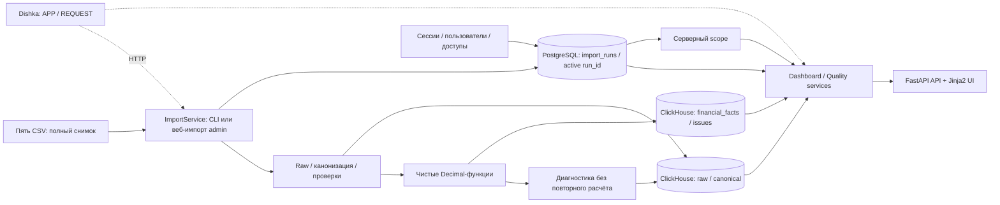

# Финансовая аналитика портфеля вилл

Работающий прототип на существующем FastAPI-каркасе: вход, финансовый dashboard,
фильтры по объекту и периоду, детализация до CSV, качество данных и история импортов.
Данные задания полностью синтетические. Результат собственника — **оценка за период
до неизвестных комиссий**, а не остаток денег и не подтверждённая сумма к выплате.

Python 3.13.7 / FastAPI / Dishka 1.7.2 / Jinja2, PostgreSQL 16.15 для пользователей, доступов,
сессий и публикации; ClickHouse 26.8.20.9 для аналитических снимков. Сохранены
`src/app`, типизированные настройки, `DatabaseHelper`, repository-стиль и общие
ошибки каркаса; ClickHouse имеет отдельный helper. RabbitMQ/Redis не нужны.
Текущие версии обработки: `quality-v1` / финансовая методология `idr-v1`.

## Просмотр подготовленного приложения

Если базы, миграции, пользователь и исходный импорт уже подготовлены, из корня проекта:

```powershell
docker compose up -d --build --wait app
Invoke-RestMethod http://localhost:8000/health/ready
```

Откройте **http://localhost:8000/login** и войдите под ранее созданным пользователем.
При действующей сессии откроется dashboard. Для просмотра повторная регистрация
и импорт не нужны. Первое развёртывание описано в следующем разделе.

Docker-образ содержит `src/` и `web/`, включая шаблоны и JavaScript/CSS.
После правок этих файлов пересоберите app указанной командой и обновите страницу.
Простой перезапуск контейнера использует прежний образ. В Compose отдельно
монтируется только `data/`; история и пользователи находятся в volumes БД.

## Запуск с нуля

Нужны Docker с Linux-контейнерами и Docker Compose v2; для локального Python и
тестов — uv (проверена версия 0.9.9). Распакуйте комплект и перейдите в каталог
`finance-dashboard`, содержащий compose.yaml. Команды ниже — PowerShell.
Образы Python/uv/PG/CH закреплены версиями и digest; Python-зависимости — uv.lock.
Первый запуск требует доступа к реестрам образов и Python-пакетов.

```powershell
if (-not (Test-Path -LiteralPath .env)) { Copy-Item -LiteralPath .env.example -Destination .env }
docker compose up -d --wait postgres clickhouse
docker compose build app
docker compose run --rm --no-deps app uv run --locked --no-dev alembic upgrade head
docker compose run --rm --no-deps app uv run --locked --no-dev python -m src.analytics.migrations
docker compose run --rm --no-deps app uv run --locked --no-dev python -m src.cli.create_user --username admin --role admin
docker compose run --rm --no-deps app uv run --locked --no-dev python -m src.cli.import_data --actor demo-operator
docker compose up -d --wait app
Invoke-RestMethod http://localhost:8000/health/ready
```

CLI создания пользователя запросит пароль скрытым вводом (12–1024 символа).
Готового пароля входа нет. Откройте **http://localhost:8000/login**, введите
`admin` и выбранный пароль. После входа откроется dashboard. Миграции повторяемы;
повтор создания того же логина корректно завершается ошибкой. Импорт повторяем
без новых фактов. Миграции запускаются отдельными командами. Импорт запускается
явно через CLI или форму admin; просмотр страниц не запускает импорт.

Публичные пароли-заглушки `.env.example` предназначены для локальной проверки.
Для общего окружения задайте собственные пароли **до первого создания volumes**;
изменение `.env` не меняет пароль пользователя в уже созданной БД. `.env` в ZIP
не включён. Пароли, токены и DSN с паролями не выводятся приложением.

Для автоматизации создания пользователя поддержан вариант с переменной процесса:

```powershell
# DEMO_PASSWORD предварительно задаётся безопасным способом в окружении процесса.
docker compose run --rm --no-deps -e DEMO_PASSWORD app uv run --locked --no-dev python -m src.cli.create_user --username owner --role viewer --property-id V019 --password-env DEMO_PASSWORD
```

Пароль не передаётся аргументом команды и не сохраняется в сдаваемых файлах.
Оператор CLI имеет доверенный серверный доступ. `--actor` — его подпись для
аудита, не доказательство веб-авторизации. Веб-импорт требует сессии admin;
автор определяется сервером по текущему пользователю.

| Назначение | Адрес по умолчанию |
|---|---|
| Вход / dashboard | http://localhost:8000/login / http://localhost:8000/dashboard |
| Качество / история admin | http://localhost:8000/quality / http://localhost:8000/imports |
| Загрузка CSV: только admin | http://localhost:8000/imports?view=upload#import-upload |
| Учётная запись / выход | http://localhost:8000/account; меню пользователя → «Выйти» |
| Swagger UI / OpenAPI | http://localhost:8000/swagger / http://localhost:8000/openapi.json |
| Liveness / readiness | http://localhost:8000/health/live / http://localhost:8000/health/ready |
| PostgreSQL / ClickHouse с хоста | localhost:55432 / localhost:58123 (HTTP) |

`/health/ready` реально обращается к обеим БД; при сбое — 503, без подстановки
нулей. `/health/live` проверяет только процесс. `docker compose ps` показывает
состояние контейнеров. Остановка с сохранением данных: `docker compose down`.
Не удаляйте volumes, если нужна история пользователей/снимков.

### Импорт через интерфейс

Войдите как admin и откройте **«Импорты» → «Загрузить CSV»** (или «Новый импорт»). Выберите одновременно
properties.csv, reservations.csv, expenses.csv, payments.csv, commission_rules.csv
из локального `data/` либо другого каталога с полным набором и нажмите
**«Импортировать набор»**. Формат и имена — из раздела «Источники» ниже:
UTF-8 с необязательным BOM, запятая, исходные колонки. Один CSV — до5МиБ,
вся multipart-загрузка с заголовками — до26МиБ. ZIP/RAR/XLSX не принимаются.
Для первого запуска через UI можно пропустить CLI-импорт в инструкции выше;
пользователь admin и миграции обеих БД по-прежнему нужны.

Во время загрузки/обработки повторная отправка блокируется. Результат содержит
run_id набора, active_run_id, ссылки на попытку, качество и финансы активного
снимка; история и её активная отметка обновляются без перезагрузки формы.
Новый снимок появляется только после общего расчёта и проверки PG/CH.
Неизменённый набор возвращает reused без новых фактов; повтор старого набора
сохраняет более новый active. Ошибка схемы CSV видна как failed-попытка.
Ошибки самой формы/лимитов отклоняются до запуска импортёра.

Исходные bytes не нормализуются и не заменяют серверный `DATA_DIR`: каждый
веб-набор хранится во временном каталоге до завершения операции, а raw/manifest
и результаты сохраняются общим pipeline. Требуются текущая admin-сессия и
точный Origin; viewer не видит форму и получает403 при прямом POST. Имена
ограничены пятью CSV, серверные пути и actor от клиента не принимаются.
После чтения прав auth-транзакция освобождает соединение до загрузки/импорта.

Другой работающий импорт даёт409. Неподходящий набор/форма —422, размер413,
не multipart415, недоступность БД или записи503. Отдельный outcome=unknown
означает неопределённый исход публикации, а не подтверждённый откат.
При обрыве связи также проверьте историю: снимок мог успеть опубликоваться.
Отмена HTTP-ожидания дожидается принадлежащей ему операции перед очисткой
временных файлов; фоновой очереди и автоматического повтора нет.

### Графики и управление блоками

Финансы разделены на серверные представления **«Обзор», «Объекты», «Операции»**
через параметр HTML `view=overview|properties|operations`. Обзор показывает четыре
ключевые карточки: начисления после OTA, поступления, расходы и результат
собственника с пометкой оценки. Gross/Net, возвраты и комиссии доступны в блоке
«Состав начислений и комиссий». Объект и период задаются в раскрываемой панели.

Карточка открывает операции выбранного показателя. Возвраты/OTA не показывают
подтверждённые нулевые компоненты; неизвестные компоненты остаются для объяснения.
Поиск по ID/объекту, тип и решение фильтруют только список, а не финансовые итоги.
Операции выводятся сервером по 25 строк с сохранением фильтров и run_id; в детализации
ссылка «Назад к финансам» сохраняет объект, даты, страницу и выбранный показатель.
Все отборы выполняются после серверной авторизации существующим сервисом.

Блоки и легенды можно сворачивать; предпочтения сохраняются в текущей вкладке.
Дополнительные графики, состав начислений и сверка первоначально свёрнуты.
Без JavaScript серверные представления, поиск, пагинация, фильтры и таблицы работают;
пустые поля HTML-форм трактуются как отсутствие фильтра до общей типовой валидации.
Защищённые JSON API сохраняют прежний контракт и проверки. Для входа и загрузки
CSV по-прежнему нужен JavaScript. Кнопки доступны с клавиатуры.

Четыре графика используют выбранный объект, период и тот же снимок, что KPI:

- Динамика основных показателей: Gross, возвраты, Net, OTA, management,
  расходы, оценка собственника и поступления. Нажатие на показатель в легенде
  скрывает/возвращает его серию. «Скрыть легенду» убирает только подписи;
  «Показать легенду» возвращает их без изменения данных.
- Начисления после OTA и поступления в календарных интервалах: разные даты
  признания сохраняются, разница не объявляется точной дебиторской задолженностью.
- Возвраты, комиссии и расходы за период: management явно в известной части.
- Оценочный результат и поступления во вкладке «Объекты», с отрицательной осью;
  сначала показаны первые восемь объектов, переключатель раскрывает все доступные.

Группировку выполняет сервер через общий `aggregate()` над уже ограниченными
правами и периодом финансовыми фактами. Динамика: день до 92 дней разницы дат,
неделя с понедельника до 730, календарный месяц до 3660, затем год/несколько лет.
Сравнение начислений/cash — по месяцам, для очень длинных периодов по годам.
Не более 128 интервалов; крайние интервалы обрезаются выбранными датами.
Это суммы за интервал, не накопительный итог. Дни без активности имеют
корректные нули; записи без даты не получают выдуманный интервал.

Неизвестная комиссия остаётся NULL и разрывом линии. Оценка собственника
помечена оценкой до неизвестных комиссий; пунктир/звёздочка и предупреждения
объясняют неполноту. Точные decimal-строки доступны в выборе периода, подсказках
и серверных таблицах под графиками. SVG использует числа только для координат;
финансовых расчётов/округления на frontend нет. Графики не требуют CDN.
На узком экране график прокручивается горизонтально, подписи сохраняют размер.
Если данных нет, графики отсутствуют и показано объяснение; сбой БД остаётся 503.

### Отдельный проверочный запуск

Для параллельного чистого окружения задайте в его собственной `.env`:
`COMPOSE_PROJECT_NAME=finance-e07-check`, `APP_PORT=18007`, `DB_PORT=55437`,
`CH_PORT=58127`, `AUTH_ORIGIN=http://localhost:18007`. Остальные значения —
из примера либо собственные пароли. Используйте команды запуска выше с
`docker compose -p finance-e07-check` вместо `docker compose`, а адрес UI —
http://localhost:18007/login. Новое имя проекта создаёт отдельные сеть/volumes;
порты также должны быть свободны. Основное окружение не останавливается.
`APP_PORT` меняет только публикацию порта контейнера; `AUTH_ORIGIN` задаётся
отдельно и должен точно совпадать с адресом браузера.

### Локальный Python и проверки

Из корня проекта, с тем же окружением БД:

```powershell
uv sync --locked
uv run --locked alembic upgrade head
uv run --locked alembic check
uv run --locked python -m src.analytics.migrations
uv run --locked python -m src.cli.create_user --username local-admin --role admin
uv run --locked python -m src.cli.import_data --actor local-operator
uv run --locked uvicorn src.app.__main__:app --host 127.0.0.1 --port 8000
```

Порт Uvicorn должен быть свободен: если работает контейнер приложения,
остановите только его: `docker compose stop app`. Локальный Python использует
DB_HOST/DB_PORT и CH_HOST/CH_PORT из `.env`; внутри Compose адреса — postgres:5432
и clickhouse:8123. Переменные процесса имеют приоритет над `.env`.
`DATA_DIR` разрешается относительно корня; Compose монтирует `data/` read-only.
`APP_DEBUG=False`, `BROKER_ENABLED=False`; таймауты DB_TIMEOUT=3, CH_TIMEOUT=3,
READINESS_TIMEOUT=5 секунд. SESSION_SECONDS=28800. Для HTTPS origin cookie Secure.
Эти таймауты настраиваются в локальном Python; текущий compose.yaml использует
их значения по умолчанию и не передаёт переопределения из `.env` в app.

```powershell
uv run --locked ruff check src web tests scripts
uv run --locked ruff format --check src web tests scripts
uv run --locked pytest -q
uv run --locked pytest -q -m integration
uv run --locked pytest -q -o addopts='' --tb=short
uv run --with playwright==1.64.0 python -m tests.browser_end_to_end
uv run --with playwright==1.64.0 python -m tests.browser_charts
uv run --with playwright==1.64.0 python -m tests.browser_import
uv run --with playwright==1.64.0 python -m tests.browser_design
```

Обычный pytest не требует БД. Полный прогон включает реальные PG/CH и создаёт
UUID-базы e01_test_*/e02_test_* с последующим удалением; тестовому пользователю
нужны права создания/удаления БД. Приложение в Docker не содержит tests/dev-зависимостей;
полный pytest запускается локальным uv. Полный прогон при переработке UI:
184 passed (132 обычных и 52 интеграционных); подробности и дата — в разделе
«Проверки, инструменты и ограничения» и журнале.

Для тестов на нестандартных портах задайте переменные процесса PowerShell.
Например, для отдельного Compose-окружения из раздела выше со стандартными
именами БД и учётными данными из `.env.example`:

```powershell
$env:DB_HOST = "localhost"
$env:DB_PORT = "55437"
$env:CH_HOST = "localhost"
$env:CH_PORT = "58127"
uv run --locked pytest -q -m integration
```

При других именах БД/учётных данных задайте также DB_NAME, DB_USER, DB_PASSWORD,
CH_DATABASE, CH_USER и CH_PASSWORD в окружении процесса, без вывода секретов.
`tests/real_environment.py` вызывает `load_settings(env_file=None)`; источником
конфигурации фикстуры является окружение процесса. Адреса `postgres:5432` и
`clickhouse:8123` предназначены для контейнеров, не для локальных тестов.
После работы в отдельном окружении восстановите прежние значения переменных
либо откройте новую сессию PowerShell для основного окружения.

Сценарии `browser_end_to_end`, `browser_charts`, `browser_import`, `browser_design` сами создают
базы, миграции, пользователей и отдельный Uvicorn, выполняют импорт через CLI
или UI. Работающий HTTP-сервис им не требуется. Они используют Chrome по
стандартному Windows-пути, иначе установленный Chromium Playwright.
При необходимости: `uv run --with playwright==1.64.0 python -m playwright install chromium`.

Дополнительные регрессии используют уже запущенный сервис по AUTH_ORIGIN
и импортированный исходный набор. Они создают и удаляют временных пользователей:

```powershell
uv run --with playwright==1.64.0 python -m tests.browser_finance
uv run --with playwright==1.64.0 python -m tests.browser_quality
```

### Финансовая детализация и нераспределённые записи

Карточка показателя ведёт к финансовой детализации; ID записи открывает её расчёт,
причины, каноническую версию и исходные строки выбранного снимка. У расхода или
платежа сумма находится в `amount`; `gross`, `refund`, `ota`, `management` относятся
к бронированию. Например, E0001 — расход 728 127 IDR: карточка показывает сумму расхода,
а неприменимые поля бронирования не выводит. Неизвестная применимая комиссия
обозначена «Не определено»; NULL не является доказанным нулём. Исходные значения,
формулы, каноническая запись и JSON доступны в отдельных раскрываемых блоках.

У показателей видны обозначения оценки и неполноты, известная часть суммы и
количество неизвестных комиссий; причины раскрываются в покрытии и качестве.
Общие пояснения из поля `warnings` API не выводятся верхним баннером dashboard;
отдельные ограничения снимка, например отсутствие достоверной даты, показываются.

Во вкладке «Операции», в блоке «Нераспределённые записи», администратор видит расходы, поступления и
брони: ID, финансовую дату, исходную сумму/валюту и причины исключения.
ID ведёт к объяснению расчёта, ссылка «Строка» — к точному CSV с исходным
property_id и остальными полями. Стоимость брони обозначена Gross и не
прибавляется к поступлениям. Блок использует текущие период и run_id,
скрыт при выборе объекта и недоступен viewer. Для исходного набора это E0017,
P0017 и R0034; их объекты V777/V999 отсутствуют в справочнике.

## Источники и происхождение

В `data/` сохранены исходный DOCX задания, README_DATA.txt и пять CSV без изменений.
UTF-8 BOM, разделитель запятая; всего 357 физических строк данных.

| Файл | Строк | Поля |
|---|---:|---|
| properties.csv | 20 | property_id, property_name, cluster, owner_id, base_currency |
| reservations.csv | 151 | reservation_id, property_id, check_in, check_out, status, gross_booking_value, currency, ota_fee, refund_amount, channel, updated_at |
| expenses.csv | 90 | expense_id, property_id, expense_date, category, amount, currency, payment_status |
| payments.csv | 76 | payment_id, reservation_id, property_id, payment_date, amount, currency, status |
| commission_rules.csv | 20 | property_id, effective_from, effective_to, management_fee_rate, fee_basis, note |

Исходные байты захватываются один раз на попытку, manifest хранит SHA-256,
размеры и числа строк. Raw сохраняет source, физический номер (первая data-строка=2),
исходный текст/payload/hash и run_id. Дубли не удаляются из raw. Канонических
записей 355: 20 объектов, 150 броней, 90 расходов, 75 платежей, 20 правил.
Даты источников не обрезаются по today(): начальный финансовый период —
01.09–05.11.2026. Поддерживаемый диапазон дат 1900–2299 по ClickHouse Date32.

Полные дубли схлопываются с сохранением всех исходных строк. У брони выбирается
единственная последняя версия по updated_at; modified учитывается как такая
версия, а не добавочный оборот. Конфликт одинакового максимального времени,
неразбираемая версия или конфликт расхода/платежа без версии видны как проблема.
Неверная последняя версия не подменяется более удобной старой. Разные payment_id
одной брони остаются разными поступлениями. Исходные CSV не исправляются.

## Финансовая методология

Все денежные строки читаются прямо в Decimal. В ClickHouse суммы Decimal(20,2),
ставки Decimal(18,8); непредставимые значения не округляются «для исправления».
Основной dashboard — IDR, поскольку это валюта всех объектов. Валюты не
смешиваются, FX не выдумывается. JSON передаёт деньги decimal-строками;
frontend только отображает серверный результат общей `src/finance/policy.py`.

Для допущенной брони: G — исходная стоимость gross до вычета комиссий,
R — исходная корректировка возврата, O — исходная OTA, r — применимая ставка:

```text
net = G − R
OTA = O
management = ROUND_HALF_UP(G × r, до целой IDR для каждой брони)
начисления после OTA = G − R − O
оценочный вклад брони = G − R − O − известная management
оценка собственника за период = сумма известных вкладов − accrued expenses
cash = сумма допустимых received по payment_date
```

Комиссия управления берётся от G, не от G−O. Сначала округляется комиссия
каждой брони, затем суммируется. Это конвенция прототипа для подтверждения CFO.
Правило выбирается по check_in: effective_from/effective_to включительны,
должно быть ровно одно применимое правило, ставка в [0,1], база gross_booking_value.
Нет правила, неоднозначность, неверная ставка/база — management=NULL с причиной.
Известные начисления при этом сохраняются, неизвестная комиссия не равна нулю.

| Область | Финансовая дата |
|---|---|
| G, R, OTA, management | check_out; вся бронь, без распределения по ночам |
| Expenses paid и pending | expense_date; дата фактической оплаты неизвестна |
| Received cash | payment_date независимо от даты/допуска начисления |
| Выбор ставки | check_in |
| Актуальность версии | updated_at (служебная дата) |

Фильтры дат включительны. Проживание 28.09–03.10 целиком начисляется 03.10.
Периоды проживания проверяются по [check_in,check_out): соседние заезды не overlap.
Updated_at без offset трактуется как UTC; timestamps с offset приводятся к UTC,
служебные timestamps сессий/импорта также UTC. Финансовые даты имеют тип date.

Confirmed/modified допускаются при валидных полях. Полная отмена G=R сохраняет
G и R отдельно, net=0 и исходную OTA; management неизвестна из-за отсутствия
условий договора. Refund повторно из cash не вычитается: дат денежных возвратов
нет. Частичная отмена исключается до подтверждения права на остаток начисления.
Отрицательные суммы/OTA, OTA>G, R>G, неверные статусы, валюты, даты и ссылки
исключают соответствующую область. Один дефект начисления не отменяет независимо
корректный платёж; противоречие объектов уводит платёж из распределённых сумм.

Расходы включают paid и pending как начисления, а не денежные выплаты. Cash
суммирует разные payment_id без умножения gross/OTA/management. При сверке
сравнивается общий допустимый cash брони и известное G−R−O (минимум 0 для
сопоставления), но разница не доказывает точную дебиторку: даты и состав различны.
OTA из net-поступления повторно не вычитается. Отсутствие платежа не означает
просрочку; нулевое received не является доказательством возврата.

Неизвестная полная management fee показана «Не определено» с известной частью
и unknown_count. Оценка до неизвестных комиссий явно помечена estimate и неполной.
Для точного owner balance отсутствуют начальное сальдо, выплаты собственникам,
полная платёжная история, даты денежных возвратов/оплаты расходов, налоги,
депозиты и договорные cancellation fee rules. Даже без технических исключений
это оценка, не бухгалтерское сальдо или сумма к выплате.

### Контрольные суммы IDR

| Показатель | Весь набор | Сентябрь 2026 | Октябрь 2026 | Ноябрь 2026 |
|---|---:|---:|---:|---:|
| Gross | 1 338 916 369 | 679 364 021 | 636 261 198 | 23 291 150 |
| Refund | 86 163 513 | 40 578 408 | 45 585 105 | 0 |
| Net | 1 252 752 856 | 638 785 613 | 590 676 093 | 23 291 150 |
| OTA | 195 531 940 | 101 170 044 | 91 233 349 | 3 128 547 |
| Management, известная часть | 222 630 407 | 112 849 957 | 105 820 954 | 3 959 496 |
| Expenses | 49 462 041 | 22 546 329 | 26 915 712 | 0 |
| Оценка до неизвестных комиссий | 785 128 468 | 402 219 283 | 366 706 078 | 16 203 107 |
| Received cash | 511 162 604 | 263 553 633 | 221 842 916 | 25 766 055 |
| Допущенные брони | 146 | 77 | 67 | 2 |
| Неизвестные комиссии отмен | 12 | 6 | 6 | 0 |

Числа — контрольные ожидания методологии, не константы приложения. 146 броней:
134 confirmed/modified +12 cancelled; 89 расходов: paid 41 079 463 и pending
8 382 578 IDR; 74 платежа: 67 положительных и 7 нулевых. Месяцы сходятся в общий итог.

Независимый пример R0002 / V019: G=11 778 798, O=1 766 820, R=0, r=0.17.
G×r=2 002 395.66 → management=2 002 396; вклад до расходов=8 009 582 IDR.
P0001=10 011 978=G−O. В октябрьском начислении и платеже это разные факты;
повторно вычитать OTA из P0001 нельзя. Откройте R0002 в детализации и сравните
формулу, правило, исходную строку reservations.csv:3 и связанный P0001.

## Найденные проблемы и обработка

| Наблюдение на исходных CSV | Решение и влияние |
|---|---|
| Полные дубли R0015, P0075 | Один canonical/финансовый факт; обе raw-строки и причина сохранены |
| R0034/P0017: V999; E0017: V777 | Неизвестные объекты, вне распределённых IDR-сумм; администратору видны исходники/нераспределённые записи |
| R0061: USD при IDR объекта | Начисление исключено, валюты не конвертированы; неизвестность не стала нулём |
| R0072: refund 7 970 068 > gross 7 070 068 | Начисление исключено; P0036 с 0 IDR независимо сохранён в cash |
| R0102: OTA −100 000 | Начисление исключено; P0051 с 3 998 667 IDR сохранён как несверенный cash |
| 12 валидных полных отмен | G/R и OTA сохранены; 12 management fees неизвестны |
| 73 пары пересечений, 87 броней, 17 объектов | Предупреждение с обеими исходными строками; допустимые деньги автоматически не исключаются |
| 30 Direct с положительной OTA | Предупреждение; положительная исходная OTA сохраняется |
| Нет строки платежа для 75 броней | Информационное наблюдение; не доказательство долга/просрочки |
| 7 нулевых received | Сохранены как нулевые движения |

Всего 222 сообщения, 140 затронутых физических строк и 138 уникальных сущностей
с учётом связей. Это не 222 финансовые ошибки: сообщения бывают информационными,
одна строка имеет несколько причин. Финансово исключены 6 canonical-сущностей
(4 брони, 1 расход, 1 платёж); 2 raw-дубля считаются отдельно. В исходных правилах
комиссий пересечений/пропусков не найдено; такие случаи проверяются искусственными
тестами и не выдаются за ошибки CSV. Проверка overlap выполняется до денежных
исключений на канонических confirmed/modified, с одной записью на пару.

Экран качества фильтрует источник, код, действие, уровень, объект, business ID
и период; показывает причину, принятое действие, влияние и raw-ссылки. Глобальные
и недатированные ограничения не скрываются периодом. Overlap фильтруется по
общим ночам; остальные сообщения — по финансовой дате своего источника.

## Архитектура, публикация и аудит

Точка сборки приложения — `src/app`. HTTP API организован по предметным
областям в `src/api/v1/`: `auth`, `finance`, `quality`, `imports`, `health`.
В каждой области отдельно находятся `schemas.py`, `service.py`, `routers.py`
и `__init__.py` с экспортами; HTTP-зависимости вынесены в `dependencies.py`,
где они нужны. Роутеры подключаются при сборке приложения, а не при импорте
сервиса из CLI. Адреса API сохранены; health остаётся на `/health/*`.

Зависимости HTTP-приложения собирает Dishka 1.7.2 в `src/app/providers.py`:

- `ApplicationProvider`, область `APP`: типизированные Settings/AuthConfig,
  DatabaseHelper и ClickHouseHelper. Общий DatabaseResources/AsyncExitStack
  закрывает оба ресурса при завершении lifespan, частичном запуске,
  ошибке закрытия другого ресурса и CancelledError.
- `RepositoryProvider`, область `REQUEST`: одна AsyncSession и репозитории.
  Сессия общая для авторизации, финансов, качества и истории внутри запроса;
  у следующего запроса своя сессия. Закрытие запроса не выполняет implicit commit.
- `ServiceProvider`, область `REQUEST`: сервисы предметных областей и общий
  ImportService с принятыми версиями обработки. Перед веб-импортом guard
  откатывает читающую auth-транзакцию; импортёр использует собственные сессии.

`create_app()` валидирует граф и подключает `setup_dishka`; `DishkaRoute` и
`FromDishka` передают зависимости в API и HTML-роутеры. Вложенные HTTP-зависимости
декорированы `@inject`. FastAPI `Depends` отвечает за параметры, текущую личность
и проверки доступа/Origin; сборкой сервисов управляет контейнер. Middleware
обработки ошибок охватывает также закрытие request-контейнера. В `app.state`
интеграция хранит контейнер Dishka; настройки и подключения разрешаются через
providers. В проверках используются типизированные provider overrides, а не
подмена ручных HTTP-фабрик. CLI собирает те же независимые сервисы явными
конструкторами и не импортирует роутеры. API закреплённой версии сверен с
[официальной интеграцией Dishka/FastAPI](https://dishka.readthedocs.io/en/stable/integrations/fastapi.html)
и установленным исходником 1.7.2.

Веб-слой находится в корневом `web/`: HTML-роутеры, `templates/`, `static/`
и настройка Jinja2. Он обращается к общим сервисам областей; финансовые правила
остаются в `src/finance/`, канонизация и публикация — в `src/services/imports/`.
Исключения приложения определены в `src/core/infra/exceptions.py`. Единый
обработчик `src/api/exception_handlers.py` преобразует их в HTTP-ответы,
а middleware в core использует переданный обработчик. Перенос модулей
не меняет финансовую методологию и не требует нового рассчитанного снимка.



HTTP-роутеры отвечают за протокол, сервисы — за сценарий, репозитории — за SQL;
финансовые функции не зависят от HTTP и драйверов. PostgreSQL транзакционно
хранит пользователей/сессии/доступы, журнал и один active_run_id. ClickHouse —
неизменяемые аналитические наборы по run_id. Такая граница продолжает заданный
каркас и позволяет проверить настоящие БД; для 357 строк отдельная витрина
агрегатов, SPA, очередь и микросервисы не оправданы. Jinja2 сокращает объём UI,
Decimal делает денежные допущения и округление проверяемыми. Две БД увеличивают
стоимость эксплуатации, поэтому протокол публикации проверяется отдельно.

Одна загрузка — полный набор. Идемпотентность определяется стабильным hash
manifest + версиями pipeline/методологии. Повтор уже опубликованного набора
возвращает прежний run без новых фактов; повтор старого набора не откатывает active.
Изменённые байты/правила создают новый полный снимок, а не накопление двух версий.

PG advisory lock удерживается на физическом соединении весь импорт; перед
публикацией проверяется владение. CH пишет с async_insert=0; read-back сверяет
количества, уникальность ключей и все поля. Лишь затем одна PG-транзакция отмечает
published и переключает active. Общей транзакции двух БД нет. Частичный CH-run
остаётся невидимым, следующая попытка получает новый UUID. После потери commit ack
новое соединение/lock перечитывает журнал: committed — успех, доказанно не committed —
failed, недоступная сверка — unknown без выдуманного rollback. CLI exit codes:
0 успех/повтор/история, 1 определённая ошибка, 2 неизвестный исход, 3 import busy.

Manifest, actor, timestamps, previous run, версии, raw и решения сохраняются.
`python -m src.cli.import_data --history` через uv/Compose читает журнал оператора;
в UI `/imports` доступен только admin. Сравнение business key/payload hash:
added / changed / absent_in_new_snapshot; отсутствие не доказывает удаление в источнике.
Смена методологии/диагностики требует новой версии и нового снимка; E03 без
расчёта и прежние E04/E05 задним числом не дописываются. Неизменённый UI фикс
run_id в E06 не требовал пересчёта.

## Доступы и HTTP-контракт

Admin видит портфель и историю; viewer — только назначенные property_id из PG,
пересечённые со справочником снимка. Пустой список даёт пустые данные, не весь
портфель. Права перечитываются при каждом запросе. Чужой выбранный объект — 403,
недоступная запись — 404; raw-версии, связи и счётчики ограничены теми же правами.
Viewer не видит историю, включая totals/manifest/actor. Доступ к старому run
не расширяет права. Все ответы используют один опубликованный run_id.

Серверная сессия: случайный token в HttpOnly/SameSite=Lax cookie, только его hash
в PG, expiry и отзыв; пароль — Argon2id. Login/logout требуют точного Origin,
поэтому localhost и 127.0.0.1 различаются. Для ручных POST укажите Origin из
AUTH_ORIGIN. Истёкшая/отозванная/поддельная сессия — 401, HTML направляет на /login.
Общий API-key каркаса пользовательскую сессию не заменяет и браузеру не выдаётся.

| Метод и путь API | Назначение и доступ |
|---|---|
| GET /health/live | Процесс жив; без сессии и запросов к БД |
| GET /health/ready | Проверка обеих БД; без сессии, 503 при недоступности |
| POST /api/v1/auth/login | username/password в JSON; доверенный Origin, создаёт cookie-сессию |
| POST /api/v1/auth/logout | Действующая сессия и доверенный Origin; отзывает сессию |
| GET /api/v1/auth/me | Текущая личность и scope |
| GET /api/v1/dashboard | state, один run_id, даты/валюта/scope, metrics, coverage, properties, records, charts, unallocated |
| GET /api/v1/properties | Разрешённый справочник |
| GET /api/v1/reservations/{reservation_id} | Бронь, платежи, правила, формулы, raw |
| GET /api/v1/financial-records/{source}/{key} | Детали reservations/payments/expenses |
| GET /api/v1/quality-issues | Фильтры, проблемы, отдельные счётчики, пагинация |
| GET /api/v1/quality-issues/{issue_id} | Причина, решение, связи, исходные строки и влияние |
| GET /api/v1/source-rows/{source}/{row_number} | Доступная исходная строка |
| GET /api/v1/imports | История и active_run_id, только admin |
| GET /api/v1/imports/{run_id} | Manifest и сравнение с base_run_id, только admin |
| POST /api/v1/imports | Пять CSV в multipart-поле files; импорт/расчёт/публикация, только admin + Origin |

Dashboard: property_id/date_from/date_to/run_id; детали — run_id. Неверные даты
или диапазон — 422. Формы фильтра/reset dashboard и переходы quality сохраняют
показанный снимок даже после параллельного импорта. Основное меню без run_id
открывает актуальный набор. `no_snapshot`, `not_calculated`, корректный `empty`
и `ready` различаются; только корректная пустая выборка содержит известные нули.
Неизвестная fee — NULL с subtotal; недоступность БД — 503. Финансовые/quality
ответы имеют Cache-Control: no-store. Подробные модели и ошибки — в OpenAPI.

`GET /api/v1/dashboard` также возвращает `charts.trend` и
`charts.cash_accrual`: шаг, интервалы с MoneyMetric и счётчик записей без даты.
В каждом интервале сохраняются value/known_subtotal/unknown_count/is_complete/
is_estimate; отсутствие рассчитанных датированных данных — charts=null.

`unallocated` содержит группы по source/currency: count, observed_amount и
records с ID, датой, исходными суммами, reasons и source_rows. Это те же факты
и период ответа; только admin без property_id. У viewer и при выборе объекта
массив пуст. Финансовые суммы не включают эти записи.

В `/financial-records/{source}/{key}` source указывается без `.csv`, например
`expenses/E0017`. В `/source-rows/{source}/{row_number}` — полное имя источника,
например `expenses.csv/18`; номера физических строк начинаются с 2 после заголовка.
Для обоих переходов передавайте run_id показанного снимка.

Список качества принимает source/code/severity/action/business_key/property_id,
date_from/date_to/run_id, section=all|period|limitations, limit=1..100 и offset>=0.
Значения по умолчанию — section=all, limit=25, offset=0. История использует
limit/offset и необязательный status=running|failed|published; деталь импорта —
необязательный base_run_id. Права применяются до списков, связей и счётчиков.

## Демонстрация на 3–5 минут

Подготовьте admin, исходный импорт и пять CSV для повторной загрузки до начала показа.

| Время | Действие и объяснение |
|---|---|
| 0:00–0:40 | Войти, показать IDR/период, начисления/cash и оценку 785 128 468; 12 неизвестных комиссий. Показать динамику, скрыть/вернуть легенду и свернуть блок |
| 0:40–1:40 | Раскрыть фильтры, выбрать V019 и октябрь; в «Операциях» найти R0002: G→OTA→management от G, округление; перейти к P0001 и исходной CSV-строке |
| 1:40–2:50 | Сбросить фильтры к портфелю; во вкладке «Операции» в нераспределённых строках открыть E0017 → CSV с V777; в качестве показать дубль R0015/P0075, R0072 refund>gross, R0102 отрицательная OTA/P0051 допустимый cash и OCCUPANCY_OVERLAP R0033/R0056 без исключения допустимых денег |
| 2:50–3:40 | Вернуться на dashboard; показать отмену R0131 с неизвестной management, историю и raw; через «Импорты» → «Загрузить CSV» повторно загрузить пять исходных CSV, показать reused и неизменность сумм (либо выполнить CLI) |
| 3:40–4:30 | Кратко показать схему, Dishka APP/REQUEST, разграничение viewer и три следующих шага; выйти |

## Вопросы CFO и дальнейшие шаги

1. Что входит в gross: налоги, cleaning, депозиты, дополнительные сборы?
2. Когда признавать доход/расход: по ночам, выезду, акту; какова точность округления?
3. Какая база и дата фиксации management; как refund/cancellation меняют fee?
4. Возвращается ли OTA; что означает положительная OTA у Direct и −100000 у R0102?
5. Все ли payment net после OTA, где банковские счета, cash refunds и начальные остатки?
6. Где выплаты собственникам и даты оплаты расходов; как получить точное owner balance?
7. Что означает USD у R0061; нужен ли FX и откуда брать курс?
8. Property_id — одна вилла или комплекс с параллельными units (объяснение overlap)?
9. Как источник выдаёт версии/удаления; кто согласует спорные операции и правила?

| Следующий шаг | Результат |
|---|---|
| Подтвердить модель с CFO | Договорные комиссии/отмены, granularity объектов, cash refunds/opening balances и согласованная трактовка результата |
| Подключить реальные источники | Адаптеры → raw/версии → проверки → общие расчёты → dashboard; устойчивые IDs, аудит, расписание; отдельный worker только при необходимости |
| Подготовить эксплуатацию | Банковская сверка, закрытие периодов/корректировки, backup/restore, мониторинг/доступы и оптимизация по реальной нагрузке |

Эти шаги описаны как развитие и не реализуются автоматически.

## Проверки, инструменты и ограничения

Полный прогон приложения при переработке UI, 23.10.2026:
**184 passed** — 132 обычных и 52 интеграционных, 443.22s.
Команда: `uv run --locked pytest -q -o addopts='' --tb=short`.

Проверены контрольные суммы всего периода и месяцев, Decimal-правила, дубли и
версии, разбиение графиков, исходные строки, фильтры и единый run_id, права,
сессии/expiry, пустые выборки и недоступность БД. HTTP-импорт проверен с manifest,
actor, повтором, изменённым и ранее загруженным набором, ошибками CSV, лимитами
и Origin. Частичная запись ClickHouse, потеря ack до/после настоящего PG commit,
недоступная сверка, отмена запроса/kill backend и конкурентные импорты проверяются
в отдельных UUID-базах. Эти отказы искусственные; реальные БД моками не заменяются.

Для Dishka проверены общая сессия внутри REQUEST, изоляция запросов/приложений,
закрытие без implicit commit при успехе, ошибке и отмене, APP cleanup при частичном
старте и CancelledError, единый HTTP error handler и сохранение OpenAPI/ServerSession.
Сохраняется одно внешнее DeprecationWarning Python о type code u.

После финального уточнения списка объектов повторены целевые проверки:
`tests/integration/test_finance_dashboard.py`, `tests/test_web_presentation.py`
и `tests/test_dishka.py` — **17 passed**, 56.45s. Полный прогон после этого
не повторялся; финансовые функции, импортер и миграции при редизайне не менялись.

На обновлённом UI прошли семь Chrome-сценариев: `browser_design`,
`browser_end_to_end`, `browser_charts`, `browser_import`, `browser_finance`,
`browser_quality`, `browser_smoke`. Проверены финансовые контроли периода/месяцев,
UI/API/run_id, отбор по карточке, пагинация, возврат с фильтрами, графики и легенды,
raw, диагностика/история, CSV-импорт/повтор, права и выход. Новый сценарий дизайна
включает ширины 320–1440 px и native GET-формы без JavaScript.
Три сценария для работающего сервиса выполнены через отдельное временное окружение
с собственными БД/Uvicorn, без тестовых пользователей в основном портфеле.
Ruff/форматирование, Docker-сборка, совпадение локальных static-файлов с исходниками
и readiness обеих БД проверены; временные БД удалены.

Историческая проверка исходного комплекта E07: запуск из распакованного ZIP
с пустыми volumes и новой `.venv`, 136 passed (92 обычных и 44 интеграционных),
367.84s, три Chrome-сценария и Docker/локальный Uvicorn. Последующие доработки
проверены указанными выше командами; полный запуск текущего ZIP в новой `.venv`
после редизайна отдельно не повторялся. Реальные результаты каждого запуска,
включая неудачи и исправления, находятся в [журнале](docs/codex/PROGRESS.md).

Использованы Codex (AI-помощник для исследования, кода, тестов и документации),
read-only AI-review, PowerShell, Python/uv, Docker Compose, pytest, Ruff,
HTTPX, Playwright/Chrome, Dishka, SQLAlchemy/Alembic и ClickHouse Connect. Финансовая
политика взята из задания/эпика и проверена контролями; AI-вывод не заменял запуск
команд, SQL/read-back и браузер. Локальная подготовка выполнялась на Windows.

Полное фактическое время E01–E07 непрерывно не измерялось, поэтому оно неизвестно.
Рекомендованные заданием 2–3 часа не выдаются за затраты. Известны длительности
отдельных тестовых прогонов и интервал наблюдаемой подготовки E07; они записаны
в журнале. Чистая верификация E07: 22.10.2026 16:16:43–16:25:21 UTC,
8 минут 38 секунд выполнения проверочных команд; это не полное время разработки.
Нет выдуманного видео или внешней публикации.

Ограничения: небольшие данные обрабатываются в памяти; нет очистки старых
CH-снимков/сессий, UI редактирования и согласования, password reset/rate limiting,
банковского закрытия/точного сальдо, production HA и интеграций с реальными
аккаунтами. CH-миграции запускает один административный процесс; изменение
применённого SQL запрещено, новые DDL добавляются с новым номером. Dishka
управляет HTTP-зависимостями; Taskiq остаётся необязательным. Проверенная локальная
конфигурация не является испытанием промышленного кластера.

После первоначальной проверки E07 на Windows остался временный кэш вне комплекта:
автоматическая проверка команд отклонила удаление каталога. Процессы Uvicorn,
контейнеры, сеть и volumes проверки остановлены/удалены, временные пароли очищены.
Подробности одноразового проверочного скрипта и его ошибки очистки — в журнале.
Это относится к изолированному проверочному окружению E07; основное приложение
для просмотра запускается командами в начале README.

## Комплект сдачи

`dist/finance-dashboard-e07.zip` содержит исходники, тесты, SQL/Alembic-миграции,
этот README, pyproject/uv.lock, Docker/пример окружения, исходные синтетические
CSV/задание, эпик и журнал. Внутри `finance-dashboard/DELIVERY_MANIFEST.json`
перечислены размеры и SHA-256 файлов; рядом с ZIP — .sha256 для самого архива.
`.env`, реальные учётные данные, .git, .venv, кэши, логи и RAR не включаются.
Сборка не зависит от tracked/untracked и правил игнорирования data/docs:

```powershell
uv run --locked python -m scripts.build_delivery
uv run --locked python -m scripts.build_delivery --verify dist/finance-dashboard-e07.zip
Get-FileHash dist/finance-dashboard-e07.zip -Algorithm SHA256
```

Архив — локальный результат. Сервис не публиковался, файлы заказчику не отправлялись.
